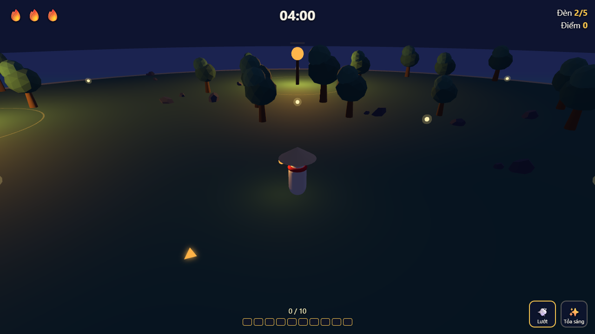

# Đảo Đèn Lồng

> 🎬 **Video demo:** *(link Release v1.0.0 / docs/demo/demo.mp4 — bổ sung khi có video)* · 📦 **Release:** [v1.0.0](../../releases/tag/v1.0.0) · Đề bài lab (giữ nguyên bản gốc): [docs/lab/](docs/lab/README.md)

Game 3D góc nhìn thứ ba chạy trên trình duyệt (Three.js), kèm chế độ headless (Node.js) theo **Test Contract v1.3**.
Mây, người giữ đèn nhỏ tuổi, gom đom đóm để thắp và **giữ các Đèn Lồng Lớn sáng tới bình minh** trên ba hòn đảo, né Bóng Mực hút dầu và Gió Lạc cướp đom đóm.



## Yêu cầu hệ thống
- **Node.js ≥ 20** (đã thử với 26.x) và npm. Chạy được trên macOS, Linux, Windows.
- Trình duyệt hỗ trợ **WebGL2** (Chrome, Edge, Firefox, Safari bản mới).
- Riêng **benchmark** cần Chrome, Edge hoặc Chromium. Script tự tìm theo đường dẫn chuẩn của từng hệ điều hành; nếu không tìm thấy, đặt biến `BENCH_BROWSER=/đường/dẫn/trình-duyệt`.
- GPU tích hợp là đủ. Máy dev: Intel i3-1125G4 + Intel UHD Graphics, 8 GB RAM.

## Cài đặt và chơi (≤ 3 lệnh)

```bash
git clone <repo> && cd <repo>
npm ci
npm start            # mở game ở http://localhost:5173 (bảng xếp hạng lưu ở data/leaderboard.json)
```

Bản chơi không cần cài đặt: tải `dao-den-long-web-v1.0.0.zip` ở [Release v1.0.0](../../releases/tag/v1.0.0), giải nén, rồi chạy một web server tĩnh trong thư mục vừa giải nén (ví dụ `python3 -m http.server 8000`, sau đó mở http://localhost:8000). Ở bản tĩnh, bảng xếp hạng lưu trong trình duyệt (localStorage).

Docker (đường Linux, chạy toàn bộ test và headless):

```bash
docker build -t dao-den-long .
docker run --rm dao-den-long                      # 108 test
docker run --rm -v "$PWD/out:/out" dao-den-long node src/headless.js --seed 1 --night 2 --ticks 600 --out /out/run.jsonl
```

## Điều khiển (đổi được trong Cài đặt)

| Mặc định | Hành động |
|---|---|
| W A S D / mũi tên | Đi (theo hướng camera) |
| Kéo chuột, Q / Z | Xoay camera |
| Space | Nhảy |
| Shift | Lướt |
| E | Nạp ánh sáng / thắp lại / châm dầu |
| F | Tỏa sáng (tốn 3 đom đóm) |
| Esc / P | Tạm dừng |

**Cài đặt:** âm lượng, độ nhạy chuột, đổi phím (báo trùng phím, có "Khôi phục mặc định"), bảng màu dễ phân biệt, giảm chuyển động, chữ lớn ×1.25, phụ đề/chỉ báo hình ảnh. Mọi cài đặt đều được lưu.

## Luật chơi
- **Ba Đêm nối tiếp:** Đảo Bến (5 đèn, 4 phút), Đảo Cau (2 đảo, cầu tre, bục nhảy, 6 đèn, 4:30), Đảo Chuông (3 tầng, dốc, gió mạnh, 7 đèn, 5 phút). Thắng thì sang Đêm kế. Thua thì chơi lại Đêm đó, hoặc lưu điểm vào bảng xếp hạng.
- Nhặt đom đóm bằng cách đi gần (≤ 1 m). Sức chứa 10, +2 mỗi lần thắp thành công (tối đa 20). Thắp lần đầu cần 10 đom đóm, thắp lại cần 5.
- Đèn sáng có 100 dầu, hao 1/giây. Châm dầu bằng E (mỗi đom đóm +10 dầu). Đèn có dầu ≥ 30 thì có vùng an toàn 6 m. Dưới 30, Bóng Mực tới hút dầu.
- **Thắng ở bình minh** nếu còn Ngọn Lửa và số đèn đang sáng ≥ 60% (3/5, 4/6, 5/7). Hết 3 Ngọn Lửa là thua.

| Điểm | |
|---|---|
| Mỗi đom đóm nạp vào đèn | +5 |
| Thắp lần đầu / thắp lại | +100 / +40 |
| Mỗi Bóng Mực trúng Tỏa Sáng | +5 (tổng +15 nếu đang hút dầu) |
| Bình minh (khi thắng): mỗi đèn sáng / mỗi Ngọn Lửa | +50 + floor(dầu) / +50 |

Tổng điểm là tổng điểm các Đêm đã thắng. Bảng xếp hạng giữ top 10.

## Lệnh theo Test Contract v1.3 ([game.contract.json](game.contract.json))

```bash
node src/headless.js --seed 42 --night 1 [--scenario s.json] [--inputs i.json] --ticks 14400 --out out.jsonl [--snapshot-every 10]
node scripts/bench.js --seed 42 --duration 30 --out bench.json       # bench_cmd (cửa sổ 1280x720, tắt vsync)
node --expose-gc src/soak.js --seed 7 --nights 10 --out soak.json    # soak_cmd
node scripts/play.js --export-leaderboard out.json                    # run_cmd + xuất bảng xếp hạng
```

- **Benchmark:** tự build `dist/` nếu chưa có, mở một cửa sổ Chrome/Edge (không toàn màn hình) với viewport 1280×720, tắt vsync và giới hạn khung hình (`--disable-gpu-vsync --disable-frame-rate-limit`), chạy cảnh bench chuẩn, khởi động 3 s, đo `--duration` giây, ghi `bench.json` rồi thoát với mã 0. `peak_mem_mb` là `null`, vì đây là bản web: trình duyệt nhiều tiến trình không cho trang đọc RSS. Lý do cũng ghi trong trường `notes`. Phần sáng tạo (cây, đá, vòng sáng) tắt trong cảnh bench.
- **Soak:** 10 Đêm trong cùng một tiến trình. Cờ `--expose-gc` để GC trước cả hai lần đo RSS.

Kết quả tự đo trên máy dev, chỉ để tham khảo (máy chấm sẽ đo lại):
- [bench.json](bench.json): `avg_fps` 112.3, `p1_low_fps` 57.5, `load_ms` 2672.
- [soak.json](soak.json): 0 crash, RSS 44.5 → 48.4 MB (tỉ lệ 1.09).

## Test và bằng chứng

```bash
npm test          # 108 test: scenario Phase 1–3, CLI/exit code, tất định, soak, bench scene, leaderboard
npm run proof     # chạy CLI thật cho mọi scenario, sinh docs/proof/phase-4/RESULTS.md
```

- Truy vết: [Phase 1](docs/proof/phase-1/TRACE.md) · [Phase 2](docs/proof/phase-2/TRACE.md) · [Phase 3](docs/proof/phase-3/TRACE.md) · [Phase 4](docs/proof/phase-4/TRACE.md)
- Spec Phase 2: [docs/spec/phase-2.md](docs/spec/phase-2.md) · ADR: [0001 dầu đèn và luật thắng](docs/adr/0001-lantern-fuel-and-dawn-win.md) · [CHANGELOG](CHANGELOG.md)
- Ghi chép: [giả định](docs/notes/assumptions.md) · [nhật ký AI](docs/notes/ai-log.md) · [retro](docs/notes/retro.md)
- Harness AI: [AGENTS.md](AGENTS.md), skill [.claude/skills/verify](.claude/skills/verify/SKILL.md), Stop hook [.claude/settings.json](.claude/settings.json)

## Kiến trúc

```
src/core/      logic thuần, tất định (không three.js, không Math.random, 60 tick/s, 12 bước mỗi tick)
  tuning.js    số chuẩn · maps.js bản đồ · game.js mô phỏng (+ cảnh bench) · leaderboard.js · validate.js · run.js
src/headless.js  CLI theo contract   ·   src/soak.js  soak test
src/web/       hiển thị, HUD, màn hình, âm thanh, đổi phím, phụ đề; gọi cùng step() của core
scripts/       play.js (run_cmd), bench.js (bench_cmd), leaderboard-store.js, proof.js, bot.js, fps.js, ui-smoke*.js
tests/         node:test; tests/scenarios.js = scenario theo yêu cầu (dùng chung cho proof)
```

## Sáng tạo của tôi

Tất cả chỉ nằm ở phần hiển thị `src/web/`, nên đầu ra headless không đổi. Phần sáng tạo cũng tắt trong cảnh bench.

1. Đèn trên nón lá của Mây sáng mạnh dần theo số đom đóm đang mang.
2. Vòng sáng lan ra khi Tỏa Sáng (tắt khi bật "Giảm chuyển động"), kèm thông báo ngắn.
3. Vòng an toàn 6 m vẽ quanh đèn còn dầu.
4. Lời dẫn của Ông Đăng cho từng Đêm, và màn Bình Minh.
5. Âm thanh tổng hợp bằng WebAudio, không dùng file asset.
6. Cây cối và tảng đá nhỏ trên ba đảo, chỉ để trang trí, không va chạm ([ảnh](docs/proof/decor/), [FPS](docs/proof/decor/fps.json)).

Bằng chứng phần lõi vẫn đúng: `src/headless.js` không import `src/web/`, và `npm test` cùng `npm run proof` đạt ở cùng commit.

## Giấy phép và ghi nguồn
[MIT](LICENSE) · [CREDITS.md](CREDITS.md)
